# Architecture

This document describes how `gokit-services` is put together — the contract every
component shares, how the lifecycle manager drives them, and the non-obvious invariants
each package upholds. It targets contributors and anyone wiring the toolkit into a
service. For usage, see the [README](README.md).

## Package organization

All library code lives under `pkg/`; the repo root holds only `example/`, `docs/` and
project files. Import paths are therefore `github.com/DjaPy/gokit-services/pkg/…` (package
names below are given relative to `pkg/`). The layout separates the *contract* from the
*transports* from the *managed resources*:

- `core/` — the orchestration layer. `core/service` holds the interfaces everything else
  implements; `core/entrypoint` is the only package that knows how to run a set of
  services. Nothing in `core/` imports a transport.
- `http/`, `grpc/`, `kafka/` — transports grouped by protocol, each split into `server`
  and `client` (or `producer`/`consumer`) subpackages. They depend on `core/service` but
  not on each other.
- Infrastructure packages — `dbservice`, `redisservice`, `healthserver`, `periodic`,
  `workerpool` — are leaf components under `pkg/` that also implement the `core/service`
  contract and are consumed the same way. `internal/` (retry, prom helpers) is shared
  within `pkg/` and not importable by consumers.

The dependency direction is strictly one-way: leaves → `core/service` ← `core/entrypoint`.
`entrypoint` depends only on the interfaces, never on a concrete transport, so the set of
components is open-ended — anything satisfying `Service` composes without touching `core/`.

The `server`/`client` subpackage names repeat across protocols on purpose; consumers alias
them at import (`httpsrv`, `httpcli`, `grpcsrv`, `grpccli`) to disambiguate and to avoid
shadowing stdlib `net/http`.

## Service contract (`core/service`)

The service contracts describe separate capabilities.

- `Service` — `Start(ctx) error`. The one required method. `Start` **blocks** until the
  service is fully stopped; the `ctx` is canceled when the entrypoint begins shutdown. A
  service that only implements `Service` treats ctx-cancellation as its sole stop signal.
- `Shutdown` — `Stop(ctx) error`. Optional graceful stop, called with a context bounded by
  the shutdown timeout. Implemented via a type assertion, so it is purely additive.
- `ReadyService` — `Service` with `StartWithReady(ctx, ready) error`. The method runs for
  the service lifetime and calls the supplied `ready()` once initialization finishes.
  It returns promptly if initialization fails or its context is canceled during startup.
- `Prober` — `Probe(ctx) error`. An ongoing readiness check used by `healthserver`.

Every component is a plain struct constructed with functional options (`Option func(*T)`)
and a `New`/`NewServer` constructor. Which optional interfaces a component satisfies is
discovered at runtime by `entrypoint` and `healthserver` through type assertions — there
are no registration calls and no compile-time interface assertions (`var _ Service = …`) in
the tree; interface conformance is asserted by the test suite instead.

## Lifecycle (`core/entrypoint`)

`Entrypoint` owns a `[]service.Service`, a shutdown timeout, the set of OS signals to catch,
four hook slices (pre/post × start/stop), and an internal `context.CancelCauseFunc` that
backs the programmatic `Shutdown()` trigger.

`Run(ctx)` executes a fixed sequence:

1. **PreStart hooks** — run sequentially; a failure aborts before anything starts.
2. **Start** — every service's `Start` is launched concurrently under a derived
   `svcCtx` (child of the caller's `ctx`) using `sync.WaitGroup.Go`. A service error is
   forwarded to a buffered channel *only* if `svcCtx` is still live — errors observed after
   cancellation are shutdown noise and dropped. With `WithFailOnUnexpectedExit`, a
   service returning `nil` before shutdown also triggers cleanup. The policy applies
   to both `Start` and `StartWithReady`.
3. **Startup readiness and PostStart hooks** — with `WithStartupReadiness`, every service
   must implement `ReadyService`, checked before PreStart. The entrypoint calls
   `StartWithReady` and waits for one signal per service. A service exit before its
   signal, a timeout, a signal from the OS, or cancellation enters the shutdown path.
   The timeout starts after PreStart and defaults to 60 seconds for non-positive values.
   Without the option, PostStart follows goroutine launch. PostStart hooks run
   sequentially, and a hook failure proceeds directly to cleanup.
   While a startup hook runs, the entrypoint listens for an OS signal, caller
   cancellation, a service error, or a programmatic shutdown. An interruption cancels
   the startup hook context and skips later startup hooks. If services have been
   launched, cleanup starts even if the interrupted hook is still running.
4. **Wait** — after successful PostStart hooks, a `select` blocks on the first of: caller
   `ctx` cancellation, an OS signal, the first service error, or the programmatic shutdown
   ctx. The result records the triggering signal or error.
5. **PreStop hooks**, then **Stop** — every service that also implements `Shutdown` has
   `Stop(stopCtx)` called concurrently within its group.
6. **PostStop hooks** — run after the service shutdown phase.

`RunWithResult` separates the triggering OS signal and cause from cleanup errors. It
joins errors from shutdown hooks and service stops together with exceeded shutdown
deadlines. After a deadline, operations that are still running may finish after the
result is returned. `Run` translates an OS signal to its legacy error and otherwise
returns the cause.

**Shutdown-context invariant.** In the default mode, shutdown first cancels the service
`ctx`. The stop phase must still be able to do bounded cleanup. The stop context is therefore built as
`context.WithTimeout(context.WithoutCancel(ctx), shutdownTimeout)` — it inherits the caller's
values but is detached from its cancellation, so a `Stop` that needs to flush or drain gets
its full timeout even though the parent `ctx` is already done. PostStop hooks run on a fresh
`context.Background()` for the same reason. Getting this wrong (using the live `ctx`, or
`context.Background()` without the parent's values) is the classic regression here.

**Ordered shutdown.** `WithShutdownGroups` registers nonempty groups in the order they
stop. Ungrouped services form the final group. All groups start concurrently. Group
contexts keep the caller's values and are canceled by the entrypoint, so caller
cancellation initiates shutdown while PreStop and earlier groups can still use their
dependencies. After PreStop, the entrypoint cancels one group's context, calls its
`Stop` methods concurrently, and waits for both `Start` and `Stop` before moving on.
After the service shutdown deadline, it cancels the remaining groups and attempts
their stops with the expired context. PreStop and PostStop each get a fresh
`WithShutdownTimeout` budget. The entrypoint proceeds after a hook's deadline even
if the hook is still running.

This sequence shows a clean SIGTERM with startup readiness and separate shutdown groups
for the HTTP API and PostgreSQL.

```mermaid
sequenceDiagram
    participant E as Entrypoint
    participant A as HTTP API
    participant D as PostgreSQL service

    E->>E: PreStart
    par Start the API
        E-)A: StartWithReady
        A-->>E: ready()
    and Start the database
        E-)D: StartWithReady
        D-->>E: ready()
    end

    E->>E: PostStart after both signals
    Note over E,D: Services are running

    Note over E: SIGTERM received
    E->>E: PreStop with both groups active
    E-)A: Cancel context and call Stop
    A-->>E: Start and Stop return
    E-)D: Cancel context and call Stop
    D-->>E: Start and Stop return
    E->>E: PostStop
    Note over E: RunWithResult returns Signal = SIGTERM
```

## HTTP (`http/server`, `http/client`)

**Server.** `Server` wraps a stdlib `*http.Server` and implements both `Service` and
`Shutdown`. `Start` binds the listener and serves; `Stop` calls `http.Server.Shutdown`.
Every request passes through a middleware chain that records four Prometheus series
(`http_request_duration_seconds`, `http_response_size_bytes`, `http_requests_inflight`,
`http_panic_recovery_total`, labeled by service/handler/method/code) and recovers panics.
On a recovered panic the client gets an RFC 7807 `application/problem+json` 500 — but only
when the response hasn't started; once bytes are on the wire the middleware can only log.

The metrics use a `prometheus.Registerer` chosen at construction. Servers on the same
registerer reuse compatible collectors through `internal/prom.RegisterOrReuse`.
`WithPrometheusRegisterer` allows tests and applications to isolate metrics.

`responseWriter` is a thin wrapper that captures status and byte count for the metrics. It
deliberately forwards `http.Flusher` and `http.Hijacker`, so streaming responses (SSE) and
connection upgrades (WebSocket) keep working through the instrumentation.

**Client.** A `Client` binds a base URL plus a `RoundTripper` middleware chain. The generic
`Do[T]` performs the request and decodes JSON into `T`: it returns an error on any non-2xx,
and the zero value without error for an empty body (`204`). Middleware is ordered
outer-to-inner as listed and is applied after all Options, so `WithMiddleware`/`WithTransport`
are order-independent. `WithBody` sets `Content-Length` automatically for bodies exposing
`Len() int` (`*bytes.Buffer`, `*strings.Reader`).

## gRPC (`grpc/server`, `grpc/client`)

`grpc/server.Server` wraps a `*grpc.Server`, exposed via `GRPCServer()` so callers register
their services before `Start`. `Start` binds and serves; `Addr()` returns the configured
address before start and the actual bound address after.

**Deterministic stop.** `Stop` distinguishes two cases up front. If the passed `ctx` is
already expired (`ctx.Err() != nil`), it forces `srv.Stop()` immediately and returns the
context error — it never enters the graceful path. Otherwise it races `GracefulStop` (guarded
by a `sync.Once`) against `ctx.Done()`; if the deadline wins first it falls back to a forced
`Stop`. The early-return matters: a graceful stop of a server with no open connections
completes instantly and could otherwise win the `select` against an already-done context,
making `Stop` return `nil` when it should have reported the context error.

**Metrics.** Both ends are instrumented out of the box by built-in unary and stream
interceptors — the server families are `grpc_server_*`, the client families `grpc_client_*`
(`_handled_total`, `_handling_seconds`, `_requests_inflight`), labeled by
`grpc_service`/`grpc_type`/`grpc_method`/`grpc_code` (the inflight gauge drops `grpc_code`).
`grpc_service` is the app name, `grpc_type` is `unary`/`client_stream`/`server_stream`/
`bidi_stream`, `grpc_method` is the full RPC method. The interceptors are chained as the
**outermost** layer, so interceptors passed via `WithServerOptions`/`WithDialOptions` are
still timed and counted rather than clobbered. As with HTTP, the metrics live behind a
`prometheus.Registerer` chosen at construction (`WithPrometheusRegisterer`), and registration
goes through `internal/prom.RegisterOrReuse` so repeated construction reuses the existing
collectors instead of panicking. Duration semantics differ by side: a server stream is timed
by the lifetime of its handler, while a client stream is observed through a
`monitoredClientStream` wrapper that records once the terminal `RecvMsg` returns — a client
stream the caller abandons without draining never records completion (see fragile points).

## Kafka (`kafka`, `kafka/producer`, `kafka/consumer`)

`kafka` is the shared transport layer: a dialer/probe with TLS and SASL (PLAIN,
SCRAM-SHA-256/512). Producer and consumer both build on it and both implement
`Service`/`Shutdown`/`Prober`.

**Producer.** `Produce`/`ProduceBatch` with configurable compression, write timeout and max
attempts. `Probe` reports broker reachability.

**Consumer.** A consumer group with per-topic `Handler`s registered via `Handle`. `Start`
fetches messages in a loop and dispatches each to a bounded `workerpool.Pool`
(`WithWorkerPoolSize`), giving concurrency with backpressure — when the pool is saturated,
`Submit` blocks the fetch loop rather than unbounded buffering.

**Offset commits.** The worker commits a handled message when its handler returns success.
Kafka tracks one committed offset per partition. A later successful message can advance that
offset past an earlier message whose handler failed or is still running, preventing redelivery
of the earlier message. The handler uses the task context, optionally bounded by
`WithHandlerTimeout`. The commit uses the service's `Start` context. Messages on topics
without a registered handler are skipped and committed immediately. Fetch errors back off
before retrying. A canceled context or closed reader ends the loop.

## Managed resources (`dbservice`, `redisservice`)

Both wrap a connection pool (`pgxpool` / `go-redis`) and implement
`Service`/`Shutdown`/`Prober` with the same shape:

- `Start` establishes the pool with a **retry-backed** connect (`WithRetry`), so a service
  can boot before its datastore is reachable and converge once it is.
- A background goroutine polls pool statistics on `WithMetricsInterval` and exports them as
  Prometheus gauges.
- `Probe` pings the backend for readiness; `Pool()` / `Client()` expose the live handle for
  application code.
- `Stop` closes the pool. (Redis's close is synchronous and ignores the stop ctx; Postgres
  closes its pool under the stop ctx.)

## Health & readiness (`healthserver`)

A tiny HTTP server exposing `/healthz` (liveness — always `200` once serving) and `/readyz`
(readiness). `/readyz` fans out to every registered `service.Prober` concurrently and returns
`200` only when all probes pass, otherwise `503`. This is the consumer side of the `Prober`
interface: `dbservice`, `redisservice` and the Kafka components plug in as probers, and
`healthserver` gates traffic on their collective readiness. Probers are registered explicitly
via `WithProber` rather than auto-discovered.

## Concurrency primitives (`periodic`, `workerpool`)

**`periodic`** runs `fn(ctx)` on an interval and implements `Service`. Two modes:
*non-overlapping* (default) skips a tick if the previous run is still going;
*overlapping* (`WithOverlapping`) launches every tick regardless. `WithImmediateStart` fires
once at `t0` before the first interval elapses. Shutdown is ctx-driven.

**`workerpool`** is a bounded goroutine pool. `New(size, …)` sets worker count;
`WithQueueSize` sizes the task channel (backpressure buffer). `Submit(ctx, task)` enqueues,
blocking until there's room or `ctx` is done, and returns an error if the pool is stopped —
a send on a closed channel is recovered and surfaced as `pool stopped` (or the ctx error if
that fired). `Task` is `func(ctx)`; the task ctx is the pool's, not the submitter's.
`WithDrainOnStop` finishes queued tasks before `Stop` returns instead of dropping them.

## Cross-cutting concurrency contract

- **Context is the stop signal.** `Start(ctx)` blocks; ctx cancellation is the universal
  "wind down" instruction. Long-running loops select on `ctx.Done()`.
- **`sync.WaitGroup.Go`** is used for fan-out (entrypoint start/stop, gRPC graceful stop,
  metrics pollers) rather than manual `Add`/`Done`.
- **Cleanup gets its own budget.** Entrypoint derives its stop context with
  `context.WithoutCancel` and a fresh timeout so service shutdown can outlive the caller's cancellation.
- **Metrics isolation.** Every metric-owning component accepts a `prometheus.Registerer`;
  the default is global. Tests must pass an isolated `prometheus.NewRegistry()`.

## Load-bearing fragile points

Non-obvious spots where a plausible-looking change reintroduces a real bug:

- **Shared Prometheus registration.** Components on the same registerer reuse compatible
  collectors. Use `WithPrometheusRegisterer` for isolated metrics, including in tests.
- **gRPC `Stop` on an expired context.** The early `ctx.Err() != nil` branch must stay — a
  graceful stop with no connections finishes instantly and would otherwise race
  `ctx.Done()`, returning `nil` instead of the context error. (Regression fixed in v0.4.1.)
- **gRPC metrics interceptor ordering.** The built-in metrics interceptor is chained as the
  outermost layer; keep it prepended when assembling the gRPC options. Registering it inner
  (or via a plain `UnaryInterceptor` that overrides the chain) drops the timing of
  user-supplied interceptors and can clobber them.
- **gRPC client-stream inflight.** `grpc_client_requests_inflight` is decremented only when
  `monitoredClientStream.RecvMsg` observes the stream's terminal error. A client stream the
  caller abandons without draining to `io.EOF`/error leaves the gauge raised and records no
  completion — an accepted limitation, not a leak to "fix" by decrementing early.
- **Entrypoint stop context.** It must be `WithoutCancel(ctx)` + timeout, never the live
  `ctx` (killed the instant shutdown starts) and never a bare `Background()` (drops the
  caller's values). PostStop hooks run on `Background()` by design.
- **Kafka commit context.** The offset commit uses the `Start` context. This gives the
  commit a lifetime independent of the handler's per-task timeout.
- **`workerpool.Submit` after stop.** Sending on the closed task channel is intentionally
  recovered; the recover-to-error path is how a stopped pool reports back instead of
  panicking the caller.