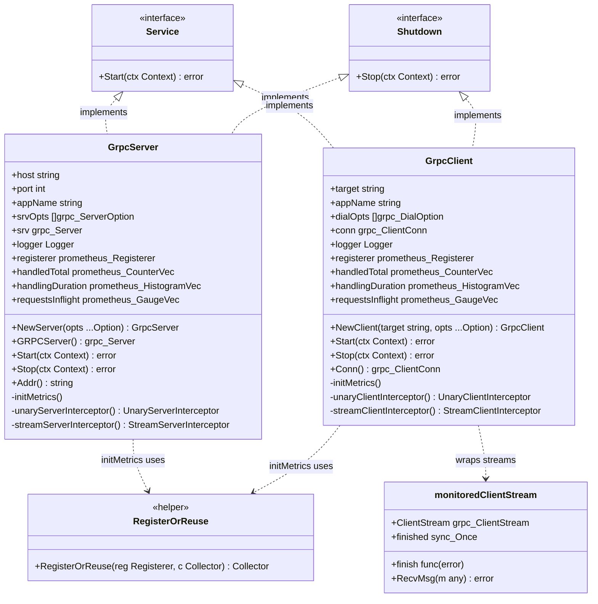

# Слой Prometheus-метрик для gRPC Server и gRPC Client

## Requirements

Добавить встроенный слой Prometheus-метрик в пакеты `pkg/grpc/server` и `pkg/grpc/client` — по прямой аналогии с уже инструментированным `pkg/http/server`, — чтобы оба конца gRPC-транспорта из коробки собирали задержку, число завершений (с кодом статуса) и число in-flight вызовов для unary и streaming RPC, конфигурировались единообразно (`WithAppName`/`WithPrometheusRegisterer`) и не затирали пользовательские interceptor'ы. Это закрывает единственный транспорт тулкита, оставшийся без наблюдаемости, и требует синхронного обновления `ARCHITECTURE.md`, `CLAUDE.md`, `CHANGELOG.md`.

## Entities



**Label-таксономия (публичный контракт метрик):**

| Метрика | Тип | Labels |
|---------|-----|--------|
| `grpc_server_handled_total` | CounterVec | `grpc_service`, `grpc_type`, `grpc_method`, `grpc_code` |
| `grpc_server_handling_seconds` | HistogramVec | `grpc_service`, `grpc_type`, `grpc_method`, `grpc_code` |
| `grpc_server_requests_inflight` | GaugeVec | `grpc_service`, `grpc_type`, `grpc_method` |
| `grpc_client_handled_total` | CounterVec | `grpc_service`, `grpc_type`, `grpc_method`, `grpc_code` |
| `grpc_client_handling_seconds` | HistogramVec | `grpc_service`, `grpc_type`, `grpc_method`, `grpc_code` |
| `grpc_client_requests_inflight` | GaugeVec | `grpc_service`, `grpc_type`, `grpc_method` |

Где `grpc_service` = appName (зеркало `http_service`), `grpc_type` ∈ {`unary`, `client_stream`, `server_stream`, `bidi_stream`}, `grpc_method` = полный метод RPC (`/pkg.Service/Method`), `grpc_code` = каноническое имя статуса (`OK`, `Canceled`, …). Gauge in-flight намеренно без `grpc_code` (код неизвестен на момент `Inc`).

## Approach

1. **Инструментация через gRPC-interceptor'ы, встроенные в конструкторы**:
   - Серверная сторона — `ChainUnaryInterceptor` + `ChainStreamInterceptor`, добавленные **первыми (внешними)** к `srvOpts` перед вызовом `grpclib.NewServer`
   - Клиентская сторона — `WithChainUnaryInterceptor` + `WithChainStreamInterceptor`, добавленные **первыми (внешними)** к `dialOpts` в `NewClient`
   - Это гарантирует, что interceptor'ы пользователя из `WithServerOptions`/`WithDialOptions` оборачиваются метрическим слоем и остаются вызванными и учтёнными (не затираются, в отличие от единичного `UnaryInterceptor`)

2. **Переиспользование существующих конвенций наблюдаемости**:
   - `internal/prom.RegisterOrReuse` — идемпотентная регистрация коллекторов, безопасна при нескольких экземплярах на `DefaultRegisterer`
   - Конфигурация: `WithAppName(string)` и `WithPrometheusRegisterer(prometheus.Registerer)` в обоих пакетах; дефолт registerer — `prometheus.DefaultRegisterer`, дефолт appName — `""`
   - `initMetrics()` вызывается в конструкторе (как `http/server`), а не в `Start`, потому что interceptor'ы должны захватить готовые метрик-вектора при сборке `*grpc.Server`/`dialOpts`

3. **Семантика замера для unary и streaming**:
   - **Unary (сервер и клиент)**: `Inc` inflight → замер вокруг `handler`/`invoker` → вычислить `grpc_code` из `status.Code(err)` → `Dec` inflight, `Inc` handled, `Observe` duration
   - **Server stream (сервер)**: handler блокируется на всё время стрима — замер вокруг `handler(srv, ss)` даёт полную длительность без обёртки
   - **Client stream (клиент)**: `streamer()` возвращается сразу; при ошибке открытия — метрика пишется немедленно; при успехе — `ClientStream` оборачивается `monitoredClientStream`, который фиксирует метрику один раз (`sync.Once`) при завершении стрима — по первому `RecvMsg`, вернувшему ошибку (`io.EOF` → `OK`, иначе `status.Code`)

4. **Общий helper `streamType`**: маппинг флагов потоковости (`IsClientStream`/`IsServerStream` на сервере, `desc.ClientStreams`/`desc.ServerStreams` на клиенте) в значение label `grpc_type`. Дублируется в обоих пакетах (production-код пакетов не зависит друг от друга — та же граница, что зафиксирована при разделении `grpc` на `server`/`client`).

5. **Тестирование на реальных RPC через стандартный gRPC health-сервис**:
   - `google.golang.org/grpc/health` + `health/grpc_health_v1` — подпакеты уже подключённого модуля grpc, новых записей в `go.mod` не добавляют
   - `Check` даёт unary-RPC, `Watch` — server-stream RPC; проверяются оба типа interceptor'а
   - Метрики читаются через `reg.Gather()` с матчингом по имени и набору label'ов
   - `go mod tidy` переведёт `github.com/prometheus/client_model` в прямые зависимости (используется в тестах для типов `dto.Metric`)

6. **Документация как часть задачи (обязательно)**: `ARCHITECTURE.md` (gRPC-секция + fragile points), `CLAUDE.md` (новый раздел про gRPC-метрики), `CHANGELOG.md` (`[Unreleased] → Added`). Секция gRPC в `ARCHITECTURE.md` сейчас описывает только жизненный цикл/`Stop` и не упоминает метрики вовсе (в отличие от HTTP-секции) — это ключевой пробел, который правка закрывает.

## Structure

### Inheritance Relationships
1. `service.Service` — контракт: `Start(ctx context.Context) error`
2. `service.Shutdown` — опциональный graceful stop: `Stop(ctx context.Context) error`
3. `*server.Server` реализует `service.Service` и `service.Shutdown`
4. `*client.Client` реализует `service.Service` и `service.Shutdown`
5. `monitoredClientStream` встраивает (`embeds`) `grpc.ClientStream` и переопределяет `RecvMsg`

### Dependencies
1. `pkg/grpc/server` (production) → `google.golang.org/grpc`, `google.golang.org/grpc/status`, `github.com/prometheus/client_golang/prometheus`, `github.com/DjaPy/gokit-services/pkg/internal/prom`, `net`, `log/slog`, `sync`, `time`, `strconv`, `fmt`, `context`
2. `pkg/grpc/client` (production) → `google.golang.org/grpc`, `google.golang.org/grpc/status`, `google.golang.org/grpc/codes`, `github.com/prometheus/client_golang/prometheus`, `github.com/DjaPy/gokit-services/pkg/internal/prom`, `log/slog`, `sync`, `time`, `errors`, `io`, `fmt`, `context`
3. `pkg/grpc/server` (test) → `google.golang.org/grpc/health`, `health/grpc_health_v1`, `github.com/prometheus/client_golang/prometheus`, `github.com/prometheus/client_model/go`
4. `pkg/grpc/client` (test) → те же тестовые зависимости + `github.com/DjaPy/gokit-services/pkg/grpc/server` (поднятие реального сервера)
5. Production-код `server` и `client` не зависят друг от друга ни в каком направлении

### Package Layout
```
pkg/grpc/server/
    server.go        — Server + метрики + interceptor'ы + streamType
    server_test.go   — существующие lifecycle-тесты (без изменений)
    metrics_test.go  — новые тесты метрик (unary + stream) через health-сервис
pkg/grpc/client/
    client.go        — Client + метрики + interceptor'ы + monitoredClientStream + streamType
    client_test.go   — существующие lifecycle-тесты (без изменений)
    metrics_test.go  — новые тесты метрик (unary + stream)
```

### Docs touched
```
ARCHITECTURE.md  — секция "## gRPC (grpc/server, grpc/client)" + "## Load-bearing fragile points"
CLAUDE.md        — новый раздел "## grpc/server, grpc/client"
CHANGELOG.md     — "[Unreleased] → ### Added"
```

### Metric Init Layer
Метрики инициализируются в конструкторе через `initMetrics()`, регистрируются в `s.registerer`/`c.registerer` посредством `prom.RegisterOrReuse`. Interceptor'ы — методы-замыкания, захватывающие уже инициализированные метрик-вектора; собираются в опции grpc до создания сервера/пула dial-опций.

## Operations

### 1. Обновить `pkg/grpc/server/server.go`
1. Импорты: добавить `time`, `github.com/prometheus/client_golang/prometheus`, `google.golang.org/grpc/status`, `github.com/DjaPy/gokit-services/pkg/internal/prom`
2. Поля структуры `Server`: добавить `appName string`, `registerer prometheus.Registerer`, `handledTotal *prometheus.CounterVec`, `handlingDuration *prometheus.HistogramVec`, `requestsInflight *prometheus.GaugeVec`
3. Опции: добавить `WithAppName(name string) Option` (устанавливает `s.appName`) и `WithPrometheusRegisterer(r prometheus.Registerer) Option` (устанавливает `s.registerer`)
4. `NewServer`: дефолт `registerer: prometheus.DefaultRegisterer`; после применения опций вызвать `s.initMetrics()`; собрать `srvOpts` как `append([]grpclib.ServerOption{ChainUnaryInterceptor(s.unaryServerInterceptor()), ChainStreamInterceptor(s.streamServerInterceptor())}, s.srvOpts...)` и передать в `grpclib.NewServer`
5. Метод `initMetrics()`: регистрирует через `prom.RegisterOrReuse`:
   - `grpc_server_handled_total` (CounterVec, labels `grpc_service, grpc_type, grpc_method, grpc_code`)
   - `grpc_server_handling_seconds` (HistogramVec, buckets `{.005,.01,.025,.05,.1,.25,.5,1,2.5,5,10}`, те же 4 label'а)
   - `grpc_server_requests_inflight` (GaugeVec, labels `grpc_service, grpc_type, grpc_method`)
6. Метод `unaryServerInterceptor() grpclib.UnaryServerInterceptor`:
   - Logic: `grpcType = "unary"`; `requestsInflight.WithLabelValues(appName, grpcType, info.FullMethod).Inc()`; `start := time.Now()`; `resp, err := handler(ctx, req)`; `code := status.Code(err).String()`; `Dec` inflight; `handledTotal...Inc()`; `handlingDuration...Observe(time.Since(start).Seconds())`; вернуть `resp, err`
7. Метод `streamServerInterceptor() grpclib.StreamServerInterceptor`:
   - Logic: `grpcType := streamType(info.IsClientStream, info.IsServerStream)`; `Inc` inflight; `start`; `err := handler(srv, ss)`; `code := status.Code(err).String()`; `Dec` inflight; `Inc` handled; `Observe` duration; вернуть `err`
8. Функция `streamType(clientStream, serverStream bool) string`: `bidi_stream` при обоих true, `client_stream`/`server_stream` по одному флагу, иначе `unary`

---

### 2. Обновить `pkg/grpc/client/client.go`
1. Импорты: добавить `errors`, `io`, `time`, `github.com/prometheus/client_golang/prometheus`, `google.golang.org/grpc/codes`, `google.golang.org/grpc/status`, `github.com/DjaPy/gokit-services/pkg/internal/prom`
2. Поля структуры `Client`: добавить `appName string`, `registerer prometheus.Registerer`, `handledTotal *prometheus.CounterVec`, `handlingDuration *prometheus.HistogramVec`, `requestsInflight *prometheus.GaugeVec`
3. Опции: добавить `WithAppName` и `WithPrometheusRegisterer` (симметрично серверу)
4. `NewClient`: дефолт `registerer: prometheus.DefaultRegisterer`; после применения опций вызвать `c.initMetrics()`; затем `c.dialOpts = append([]grpclib.DialOption{WithChainUnaryInterceptor(c.unaryClientInterceptor()), WithChainStreamInterceptor(c.streamClientInterceptor())}, c.dialOpts...)`
5. Метод `initMetrics()`: `grpc_client_handled_total`, `grpc_client_handling_seconds` (те же buckets), `grpc_client_requests_inflight` — набор label'ов идентичен серверным, имена с префиксом `grpc_client_`
6. Метод `unaryClientInterceptor() grpclib.UnaryClientInterceptor`:
   - Logic: `grpcType = "unary"`; `Inc` inflight (labels `appName, grpcType, method`); `start`; `err := invoker(ctx, method, req, reply, cc, opts...)`; `code := status.Code(err).String()`; `Dec` inflight; `Inc` handled; `Observe` duration; вернуть `err`
7. Метод `streamClientInterceptor() grpclib.StreamClientInterceptor`:
   - Logic: `grpcType := streamType(desc.ClientStreams, desc.ServerStreams)`; `Inc` inflight; `start`; `clientStream, err := streamer(...)`;
   - если `err != nil`: `code := status.Code(err).String()`; `Dec` inflight; `Inc` handled; `Observe`; вернуть `nil, err`
   - иначе вернуть `&monitoredClientStream{ClientStream: clientStream, finish: func(streamErr error){ code := streamStatusCode(streamErr).String(); Dec inflight; Inc handled; Observe }}, nil`
8. Функция `streamType(...)`: идентична серверной
9. Функция `streamStatusCode(err error) codes.Code`: `err == nil || errors.Is(err, io.EOF)` → `codes.OK`, иначе `status.Code(err)`
10. Тип `monitoredClientStream`:
    - Поля: встроенный `grpclib.ClientStream`, `finish func(error)`, `finished sync.Once`
    - Метод `RecvMsg(m any) error`: `err := s.ClientStream.RecvMsg(m)`; если `err != nil` → `s.finished.Do(func(){ s.finish(err) })`; вернуть `err`

---

### 3. Создать `pkg/grpc/server/metrics_test.go` (package `server_test`)
1. Helper `startHealthServer(t, opts...) *grpc.ClientConn`: поднять `NewServer(WithPort(0), WithHost("127.0.0.1"), opts...)`, зарегистрировать `healthpb.RegisterHealthServer(srv.GRPCServer(), health.NewServer())`, запустить `Start` в горутине, `require.Eventually` до появления адреса, вернуть dial-соединение; teardown через `t.Cleanup`
2. `TestGrpcServer_UnaryMetrics`: изолированный `prometheus.NewRegistry()` + `WithAppName`; вызвать `Health/Check`; проверить `grpc_server_handled_total{...,grpc_code=OK}==1`, `histogram sample count==1`, `grpc_server_requests_inflight==0`
3. `TestGrpcServer_StreamMetrics`: вызвать `Health/Watch`, один `Recv`, отменить контекст; `require.Eventually` до `grpc_server_handled_total{grpc_type=server_stream,grpc_code=Canceled}==1`; `inflight==0`
4. Helpers: `counterValue`, `gaugeValue`, `histogramCount`, `findMetric`, `labelsMatch`, `withCode` — чтение метрик через `reg.Gather()` и матчинг по label'ам (тип `dto.Metric` из `github.com/prometheus/client_model/go`)

---

### 4. Создать `pkg/grpc/client/metrics_test.go` (package `client_test`)
1. Helper `startInstrumentedClient(t, reg, appName) *grpc.ClientConn`: поднять health-сервер с **изолированным** серверным registerer (`prometheus.NewRegistry()`, чтобы серверные метрики не мешали клиентским), затем `grpccli.NewClient(...)` с `WithAppName`, `WithPrometheusRegisterer(reg)`, insecure dial-опцией; `Start` в горутине; дождаться `Conn() != nil`; teardown через `t.Cleanup`
2. `TestGrpcClient_UnaryMetrics`: `Health/Check`; проверить `grpc_client_handled_total{grpc_code=OK}==1`, `histogram count==1`, `grpc_client_requests_inflight==0`
3. `TestGrpcClient_StreamMetrics`: `Health/Watch`; один `Recv` (успех); отменить контекст; повторный `Recv` (терминальная ошибка); проверить `grpc_client_handled_total{grpc_type=server_stream,grpc_code=Canceled}==1`, `inflight==0`
4. Метрик-хелперы аналогичны серверному тест-файлу (в отдельном пакете `client_test`, дублирование допустимо)

---

### 5. Обновить `ARCHITECTURE.md`
1. Секция `## gRPC (grpc/server, grpc/client)` (сейчас описывает только `GRPCServer()`/`Start`/`Addr` и детерминированный `Stop`, метрик нет): добавить абзац **Metrics**, зеркальный HTTP-абзацу, покрывающий:
   - оба конца инструментированы встроенными unary+stream interceptor'ами; серверные семейства `grpc_server_*`, клиентские `grpc_client_*`; label'ы `grpc_service`/`grpc_type`/`grpc_method`/`grpc_code`
   - interceptor'ы подключаются **внешним слоем** (chaining), поэтому пользовательские interceptor'ы из `WithServerOptions`/`WithDialOptions` остаются учтёнными
   - метрики за `prometheus.Registerer`, выбираемым в конструкторе (`WithPrometheusRegisterer`); appName → label `grpc_service`
   - семантика длительности: серверный стрим меряется временем жизни handler'а; клиентский стрим наблюдается через обёртку `monitoredClientStream`, фиксирующую завершение по терминальному `RecvMsg` (недочитанный стрим метрику не закрывает)
2. Секция `## Load-bearing fragile points`: добавить два пункта:
   - **gRPC interceptor ordering** — метрический interceptor обязан оставаться внешним (первым) при сборке опций; иначе длительность/учёт пользовательских interceptor'ов искажается
   - **gRPC client-stream inflight** — `grpc_client_requests_inflight` декрементируется только при завершении стрима через `monitoredClientStream.RecvMsg`; брошенный недочитанный стрим оставляет gauge приподнятым (осознанное ограничение)
3. Не менять остальные секции `ARCHITECTURE.md`

---

### 6. Обновить `CLAUDE.md` и `CHANGELOG.md`
1. `CLAUDE.md`: добавить раздел `## grpc/server, grpc/client` после `## http/client` — встроенная инструментация, опции `WithAppName`/`WithPrometheusRegisterer`, набор метрик, label-таксономия, семантика длительности серверного и клиентского стрима, факт chaining (внешний interceptor)
2. `CHANGELOG.md`: в `[Unreleased]` создать `### Added` с описанием gRPC-метрик, новых опций, полного набора семейств и label'ов, поведения chaining

---

### 7. Валидация
1. `go build ./...` — компиляция без ошибок
2. `go mod tidy` — перевод `github.com/prometheus/client_model` в прямые зависимости; `go.mod` без предупреждений
3. `go vet ./...` — без замечаний
4. `gofmt -l .` — пусто
5. `go test ./pkg/grpc/...` — все тесты проходят (lifecycle + metrics)
6. `go test -race ./pkg/grpc/...` — без гонок
7. `golangci-lint run ./pkg/grpc/...` — 0 issues (если линтер доступен)

## Norms

1. **Именование метрик**: `grpc_<side>_<subject>` (`grpc_server_handled_total`, `grpc_client_handling_seconds`, …); label appName — `grpc_service` (единый паттерн `<protocol>_service` с `http_service`/`kafka_service`)
2. **Functional options**: `WithAppName`, `WithPrometheusRegisterer` — идентичны по форме серверным/клиентским опциям `http/server`; дефолт registerer — `prometheus.DefaultRegisterer`
3. **Регистрация коллекторов**: только через `internal/prom.RegisterOrReuse` — никаких прямых `reg.MustRegister`; идемпотентность на общем registerer обязательна
4. **Interceptor chaining**: метрический interceptor подключается через `ChainUnary/StreamInterceptor` (сервер) и `WithChainUnary/StreamInterceptor` (клиент), добавляется **первым** к пользовательским опциям — внешний слой
5. **Код статуса**: только `status.Code(err).String()`; для завершения клиентского стрима — `io.EOF` трактуется как `OK` через `streamStatusCode`
6. **Баланс inflight**: каждому `Inc` соответствует ровно один `Dec` на всех путях (успех, ошибка открытия стрима, завершение стрима через `sync.Once`)
7. **Тесты**: `package X_test` (black-box), изолированный `prometheus.NewRegistry()`, реальные RPC через стандартный health-сервис на `127.0.0.1:0`, `require.Eventually` вместо `time.Sleep`, именованные переменные для таймаутов/ожидаемых значений (без магических чисел)
8. **Без compile-time interface-ассертов**: не добавлять `var _ Interface = (*T)(nil)` — соответствие интерфейсам проверяется тестами
9. **Границы зависимостей**: production-код `server` и `client` не импортируют друг друга; `client_test` может импортировать `server`
10. **`sync.WaitGroup.Go`**: при необходимости горутин в коде использовать `wg.Go(...)` (существующий стиль пакетов), а не ручной `Add`/`Done`
11. **Документация — часть определения готовности**: `ARCHITECTURE.md`, `CLAUDE.md`, `CHANGELOG.md` синхронизируются в той же задаче, не отдельным шагом

## Safeguards

1. **Функциональные ограничения**:
   - Существующее поведение `Start`/`Stop`/`Addr`/`Conn`/`GRPCServer` не меняется — метрики добавляются как прозрачный слой interceptor'ов
   - Все существующие lifecycle-тесты (`TestGrpcServer_*`, `TestGrpcClient_*`) продолжают проходить без изменений
   - Метрики активны по умолчанию; при отсутствии `WithAppName` label `grpc_service` пуст

2. **Ограничения корректности данных**:
   - `grpc_*_requests_inflight` обязан возвращаться к нулю после завершения каждого unary-RPC и серверного стрима (проверяется тестами)
   - Метрика завершения клиентского стрима пишется ровно один раз (`sync.Once`)
   - **Известное ограничение**: если потребитель не дочитывает клиентский `client_stream`/`bidi_stream` до терминального `RecvMsg`, метрика завершения не сработает и inflight по этому стриму не декрементируется — задокументировать в `ARCHITECTURE.md`/`CLAUDE.md`, не считать дефектом

3. **Ограничения совместимости interceptor'ов**:
   - Interceptor'ы из `WithServerOptions`/`WithDialOptions` должны оставаться вызванными и учтёнными — метрический слой их оборачивает, а не затирает
   - Порядок «метрический interceptor — внешний» — инвариант; при правках сборки опций не нарушать (зафиксирован как fragile point в `ARCHITECTURE.md`)

4. **Ограничения registerer**:
   - Несколько `NewServer`/`NewClient` на одном registerer не паникуют (гарантия `RegisterOrReuse`)
   - Инвариант «одно имя метрики — один набор label'ов»: серверные и клиентские метрики имеют разные имена (`grpc_server_*` vs `grpc_client_*`), пересечения набора label'ов под одним именем нет

5. **Ограничения зависимостей**:
   - Никаких новых прямых прод-зависимостей: `prometheus/client_golang`, `google.golang.org/grpc` (со `status`/`codes`) уже в `go.mod`
   - `google.golang.org/grpc/health*` — только тестовый импорт (подпакеты уже подключённого модуля)
   - `github.com/prometheus/client_model` — тестовый импорт; после `go mod tidy` числится прямой зависимостью

6. **API-контракты**:
   - `server.Option` и `client.Option` пополняются `WithAppName`/`WithPrometheusRegisterer` — обратносовместимо (только добавление)
   - Контракт метрик (имена, типы, label'ы из таблицы в Entities) — публичный; менять только осознанно с отметкой в `CHANGELOG`

7. **Ограничения тестирования**:
   - Каждый тип RPC (unary + server_stream) покрыт и на сервере, и на клиенте
   - Тесты используют изолированный registerer; серверный registerer в клиентских тестах также изолирован, чтобы не смешивать `grpc_server_*` и `grpc_client_*`
   - `go test -race ./pkg/grpc/...` — без гонок; `golangci-lint` — 0 issues

8. **Ограничения документации**:
   - `ARCHITECTURE.md`: gRPC-секция получает абзац Metrics, зеркальный HTTP; в fragile points добавлены interceptor ordering и client-stream inflight; остальные секции не трогаются
   - `CLAUDE.md` и `CHANGELOG.md` синхронизированы с фактическим набором метрик и опций
   - Panic-recovery для gRPC и метрика размера сообщений — **вне объёма** этой задачи (отмечены в analysis как возможные будущие расширения)
